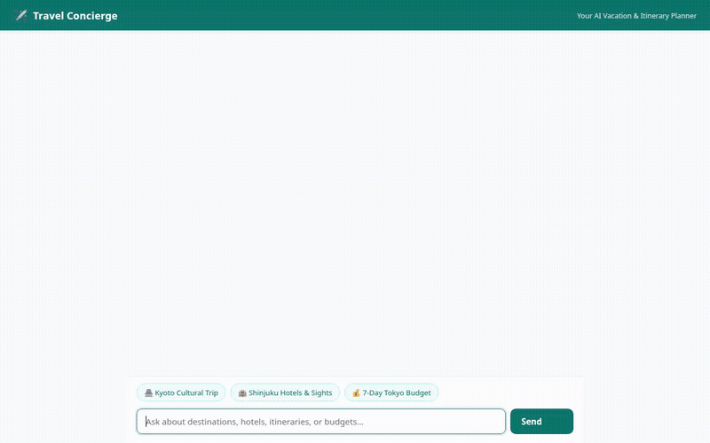

# Travel Concierge

An AI-powered vacation and itinerary planner built with the Google Agent Development Kit (ADK) and Google Cloud services. Travel Concierge assists travelers with destination discovery, attraction and hotel exploration, budget estimations, scenic image generation, and short promotional video clips.



---

## What the Agent Does

Travel Concierge combines multimodal generative models with real-world Google Cloud services and APIs to assist travelers across their trip-planning lifecycle:

* **Cross-Session Long-Term Memory (Vertex AI Memory Bank)**: Automatically retains traveler location preferences, home city, transit preferences, and dietary/mobility needs across sessions using `PreloadMemoryTool` and post-turn memory extraction callbacks.
* **Destination Catalog & Travel Notes (Google Cloud Firestore)**: Queries a curated destination database (`search_destinations`, `get_destination_details`) and persists personalized travel notes and wishlists (`save_travel_note`, `list_travel_notes`).
* **Places & Geocoding (Google Maps Platform APIs)**: Resolves coordinates for addresses and landmarks (`geocode_address`) and looks up nearby accommodations, attractions, and restaurants (`find_nearby_places`).
* **Trip Budgeting Math (Local Calculation)**: Estimates daily and multi-day travel expenses broken down by lodging, meals, transit, and activities with per-traveler totals (`calculate_trip_budget`).
* **Scenic Postcard Generation (Gemini Image & Google Cloud Storage)**: Generates scenic travel postcards using `gemini-3.1-flash-lite-image`, registers the image with `tool_context.save_artifact`, and uploads to public Cloud Storage buckets returning a public URL.
* **Scenic Video Generation (Gemini Omni & Google Cloud Storage)**: Generates short scenic travel video clips using `gemini-omni-flash-preview` via the Interactions API, saves the video as an ADK session artifact, and uploads the video bytes to public Cloud Storage.
* **Rich Card UI (A2UI)**: Formats recommendations as structured A2UI cards (Basic Catalog v0.8) containing headings, columns, rows, images, and text hints rendered natively in both local dev UI and the custom frontend.

> **Note on Roadmap**: Dynamic code execution sandboxes for live currency market conversion were explored in the project brief but are marked as **planned, not yet implemented** in favor of deterministic budgeting tools.

---

## Wired Google Cloud Services

1. **Vertex AI Agent Runtime**: Deployed ADK reasoning engine serving A2A protocol endpoints.
2. **Vertex AI Memory Bank**: Managed long-term conversational memory store.
3. **Google Cloud Firestore**: Serverless document store for destination packages and traveler notes.
4. **Google Cloud Storage**: Public media storage for generated postcards and video clips.
5. **Google GenAI Models**:
   - `gemini-2.5-flash` (Agent Core Reasoning)
   - `gemini-3.1-flash-lite-image` (Image Generation)
   - `gemini-omni-flash-preview` (Video Generation)
6. **Google Maps Platform**: Geocoding and Places API for live location lookups.
7. **Cloud Run**: Serverless container host for the FastAPI proxy and chat web interface.

---

## Architecture

```
User (Browser)
    │
    ▼
FastAPI Proxy / Web UI (frontend/)
    │  (A2A Protocol / JSON-RPC over HTTP)
    ▼
ADK Travel Concierge Agent (app/)
    ├── Vertex AI Memory Bank (cross-session memory)
    ├── Firestore (destinations & travel notes)
    ├── Google Maps API (places & geocoding)
    ├── Gemini Image & Omni Video Models (media generation)
    └── Google Cloud Storage (public assets & artifacts)
```

---

## Local Setup & Running

### Prerequisites

- Python 3.12+
- `uv` package manager or `pip`
- Google Cloud CLI (`gcloud`) authenticated with Application Default Credentials:
  ```bash
  gcloud auth application-default login
  ```

### 1. Run the Agent Locally (ADK Web)

To run the local ADK developer playground with Memory Bank support:

```bash
cd travel-concierge
uv run adk web . --port 8080 --reload_agents --memory_service_uri=agentengine://<MEMORY_BANK_ID>
```

### 2. Run the Custom Chat Frontend

To run the lightweight chat interface locally:

```bash
cd travel-concierge/frontend
python3 -m venv .venv
source .venv/bin/activate
pip install -r requirements.txt

export AGENT_ENGINE_RESOURCE_NAME="projects/<PROJECT_NUMBER>/locations/us-east1/reasoningEngines/<REASONING_ENGINE_ID>"
export AGENT_DIRECTORY="app"
export PORT="8080"

python main.py
```

Open a web browser to the local port (e.g. port 8080) to interact with the concierge.

---

## Project Structure

```
├── agents-cli-manifest.yaml   # Agent Engine deployment configuration
├── demo.gif                   # Recorded demonstration of the agent
├── pyproject.toml             # Project dependencies and packaging
├── app/
│   ├── agent.py               # Root agent definition, instruction & tool registry
│   ├── fast_api_app.py        # FastAPI server & A2A route wiring
│   ├── a2ui_utils.py          # A2UI response formatter callback
│   ├── tools_firestore.py     # Firestore catalog search & travel note tools
│   ├── tools_maps.py          # Google Maps geocoding & nearby places lookup
│   ├── tools_budget.py        # Trip budget calculation
│   ├── tools_image.py         # Gemini image postcard generation & GCS upload
│   ├── tools_video.py         # Gemini Omni video generation & GCS upload
│   └── app_utils/             # Service registries and session/artifact handlers
└── frontend/
    ├── main.py                # FastAPI proxy connecting browser to agent via A2A
    ├── requirements.txt       # Frontend proxy dependencies
    └── static/
        └── index.html         # Dialogue UI with A2UI renderer & suggestion chips
```
